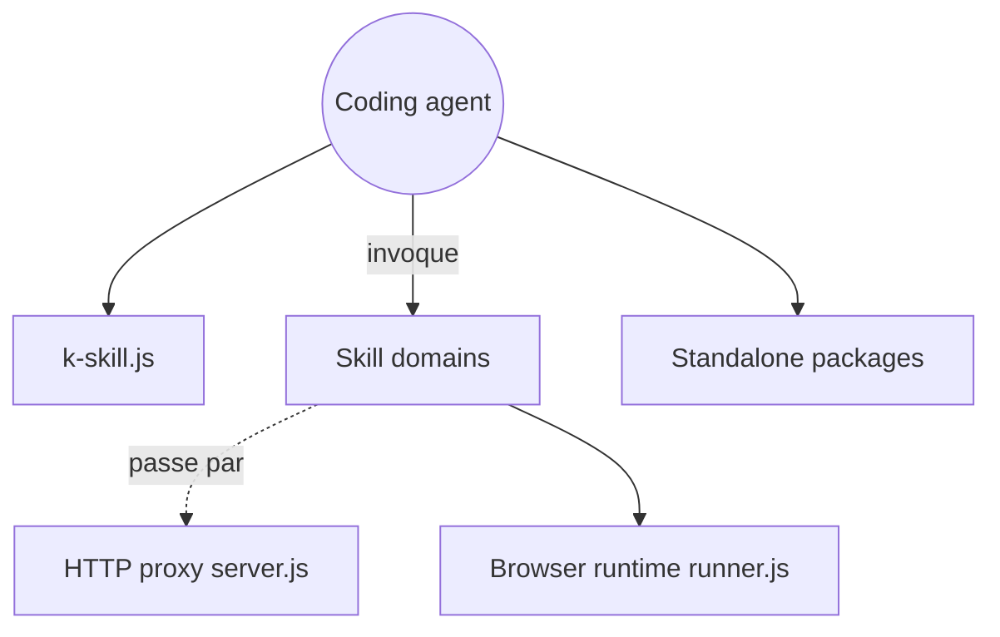

# NomaDamas/k-skill

> 125 skills pour agents de code qui automatisent des tâches du quotidien en Corée (transports, démarches, finance).

## Le problème
Les agents de code ne savent pas interroger les services et API publiques coréens (KTX, DART, Naver, Kakao, administrations).

## Ce que ça fait vraiment
Regroupe 125 skills par domaine : transport, immobilier, droit, entreprises et fiscalité, aides publiques, emploi, finance, santé, commerce, sport, culture. Beaucoup sont en lecture seule. Certains passent par un proxy HTTP optionnel (`k-skill-proxy`) vers les API publiques ; d'autres ont besoin de clés ou d'un navigateur. Le README est en coréen.

## Comment c'est branché


## Essayer
```bash
npx --yes skills add NomaDamas/k-skill --all -g
npx --yes skills add NomaDamas/k-skill --skill railway-timetable -g
/plugin marketplace add NomaDamas/k-skill
/plugin install k-skill@k-skill
```

## Coût et pièges
Node 18+ ; Python 3.11+ et `uv` pour le helper KTX. Clés d'API à obtenir via `k-skill-setup`. Licence : MIT, sauf `packages/k-skill-proxy/` et `infra/k-skill-proxy-dashboard/` en AGPL-3.0-only.

## Ce que ce n'est pas
Pas un outil de réservation pour le rail : le skill ferroviaire est en lecture seule. Les skills dépendent de sites tiers, qui peuvent bloquer ou changer. Usage limité aux informations publiques, non massif.

## Alternatives
Aucune alternative nommée dans le README.

## Pour toi
Ignorer : spécifique à la Corée et au quotidien ; seul l'agencement d'un catalogue de skills avec proxy partagé peut inspirer.

