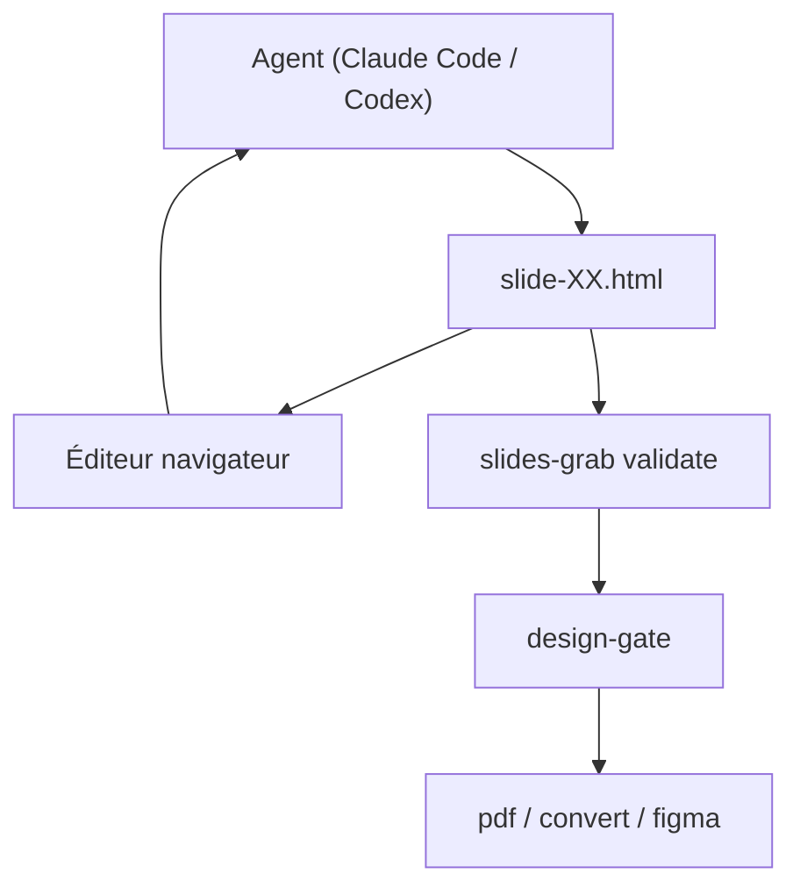

# NomaDamas/slides-grab

> Tool to have a coding agent create and touch up HTML presentations, by pointing at the area to change.

## The problem
Agents generate slides, but you cannot visually show what you want modified.

## What it actually does
Slides are HTML/CSS files. An in-browser editor lets you select an area, edit the text or ask the agent for a rewrite. The CLI exports to PDF and PNG, and to PPTX or Figma (experimental, unstable). It provides 95 design styles and skills for Claude Code and Codex.

## How it is wired


## Trying it
```bash
npm install slides-grab
npx playwright install chromium
npx slides-grab install-skills --target all --scope user
slides-grab edit --slides-dir decks/my-deck
slides-grab pdf --slides-dir decks/my-deck --output decks/my-deck.pdf
```

## Cost and gotchas
Node 20+ and Chromium via Playwright. Default images go through a private, unsupported Codex backend, which may break; OpenAI or Gemini providers with a key as fallback.

## What it is not
Not an autonomous generator: it needs a coding agent. The PPTX and Figma exports are unstable and need manual touch-ups.

## Alternatives
No alternative named in the README, apart from the ppt_team_agent project it derives from.

## For you
Watch: useful for producing decks with an agent, but the unstable PPTX and the dependency on a private backend limit professional use.
