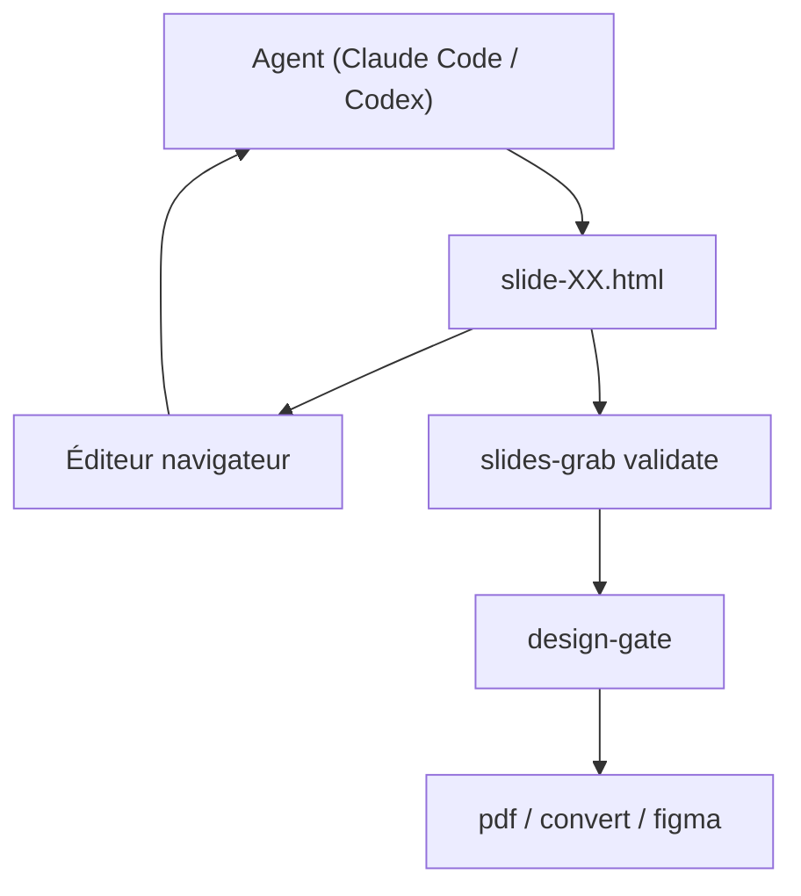

# NomaDamas/slides-grab

> Outil pour faire créer et retoucher des présentations HTML par un agent de code, en pointant la zone à changer.

## Le problème
Les agents génèrent des slides, mais on ne peut pas montrer visuellement ce qu'on veut modifier.

## Ce que ça fait vraiment
Les slides sont des fichiers HTML/CSS. Un éditeur dans le navigateur permet de sélectionner une zone, d'éditer le texte ou de demander une réécriture à l'agent. La CLI exporte en PDF et PNG, et en PPTX ou Figma (expérimental, instable). Elle fournit 95 styles de design et des skills pour Claude Code et Codex.

## Comment c'est branché


## Essayer
```bash
npm install slides-grab
npx playwright install chromium
npx slides-grab install-skills --target all --scope user
slides-grab edit --slides-dir decks/my-deck
slides-grab pdf --slides-dir decks/my-deck --output decks/my-deck.pdf
```

## Coût et pièges
Node 20+ et Chromium via Playwright. Les images par défaut passent par un backend Codex privé et non supporté, qui peut casser ; fournisseurs OpenAI ou Gemini avec clé en repli.

## Ce que ce n'est pas
Pas un générateur autonome : il faut un agent de code. Les exports PPTX et Figma sont instables, avec retouches manuelles.

## Alternatives
Aucune alternative nommée dans le README, hormis le projet ppt_team_agent dont il dérive.

## Pour toi
Surveiller : utile pour produire des decks avec un agent, mais le PPTX instable et la dépendance à un backend privé limitent un usage professionnel.

