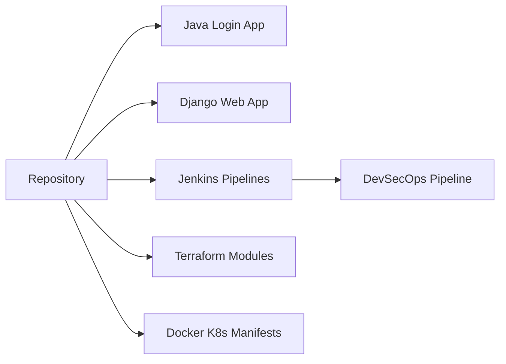

# NotHarshhaa/DevOps-Projects

> Collection of guided DevOps and cloud projects, from beginner to advanced, for practice.

## The problem
Learning DevOps requires concrete end-to-end cases, not just theory.

## What it actually does
41 listed projects: 3-tier Java on AWS, VPC, Django on ECS, Jenkins pipelines, Terraform, EKS, Azure DevOps, DevSecOps (Trivy, SonarQube), Prometheus/Grafana monitoring. Each subfolder has its own README. A Next.js site presents the list.

## How it is wired

## Trying it
No command at the root level: open the subfolder of the desired project and follow its README.

## Cost and gotchas
Each exercise uses cloud services (EC2, EKS, RDS...) billed to you. No license: reuse of the content is not framed.

## What it is not
Not an installable tool nor a production reference.

## Alternatives
- AWS-Projects: repository by the same author, focused on AWS.

## For you
Worth watching as a bank of MLOps exercises (CI/CD, Terraform, K8s), keeping an eye on the cloud bill.
