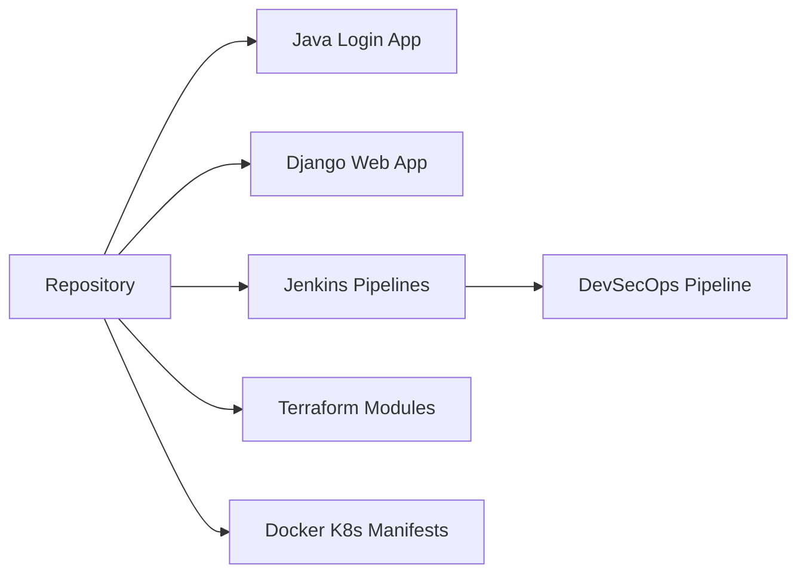

# NotHarshhaa/DevOps-Projects

> Collection de projets DevOps et cloud guidés, du débutant à l'avancé, pour s'entraîner.

## Le problème
Apprendre le DevOps demande des cas concrets de bout en bout, pas seulement de la théorie.

## Ce que ça fait vraiment
41 projets listés : Java 3-tier sur AWS, VPC, Django sur ECS, pipelines Jenkins, Terraform, EKS, Azure DevOps, DevSecOps (Trivy, SonarQube), monitoring Prometheus/Grafana. Chaque sous-dossier a son README. Un site Next.js présente la liste.

## Comment c'est branché

## Essayer
Aucune commande au niveau racine : ouvrir le sous-dossier du projet voulu et suivre son README.

## Coût et pièges
Chaque exercice mobilise des services cloud (EC2, EKS, RDS…) facturés à ta charge. Licence absente : réutilisation du contenu non cadrée.

## Ce que ce n'est pas
Pas un outil installable ni une référence de production.

## Alternatives
- AWS-Projects : dépôt du même auteur, centré AWS.

## Pour toi
À surveiller comme banque d'exercices MLOps (CI/CD, Terraform, K8s), en gardant l'œil sur la facture cloud.

