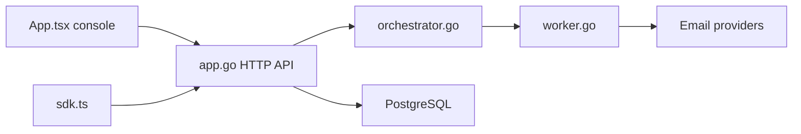

# Notifuse/notifuse

> A self-hosted emailing, transactional and automation platform, an alternative to Mailchimp or Brevo.

## The problem
Emailing tools charge per send and keep your data on their side.

## What it actually does
React console and Go API on PostgreSQL: MJML visual editor, campaigns, A/B tests, segmentation, automation journeys (delays, branches, webhooks), transactional API, Liquid templates. Sending via SES, Mailgun, Postmark, Mailjet, SparkPost, SendGrid or SMTP. Built-in cookieless web analytics, S3 file manager, notification center. A cloud offering starting at $16/month exists.

## How it is wired


## Trying it
```bash
# Aucune commande exacte dans ce README : assistant d'installation interactif
# et documentation externe ; fichier compose.alloydb.yaml pour AlloyDB Omni.
```

## Cost and gotchas
You need a sending provider (cost on you), PostgreSQL 17+, a GeoLite2 database included. The license is not identified by GitHub: to be checked.

## What it is not
Not a mail server: it sends through a third-party provider. The price of the hosted offering is the one in the README, with no guarantee.

## Alternatives
Listmonk, Mailchimp, Brevo, Mailjet (cited as equivalents).

## For you
Worth watching: interesting for sending alerts or newsletters from your platform, after confirming the license.
