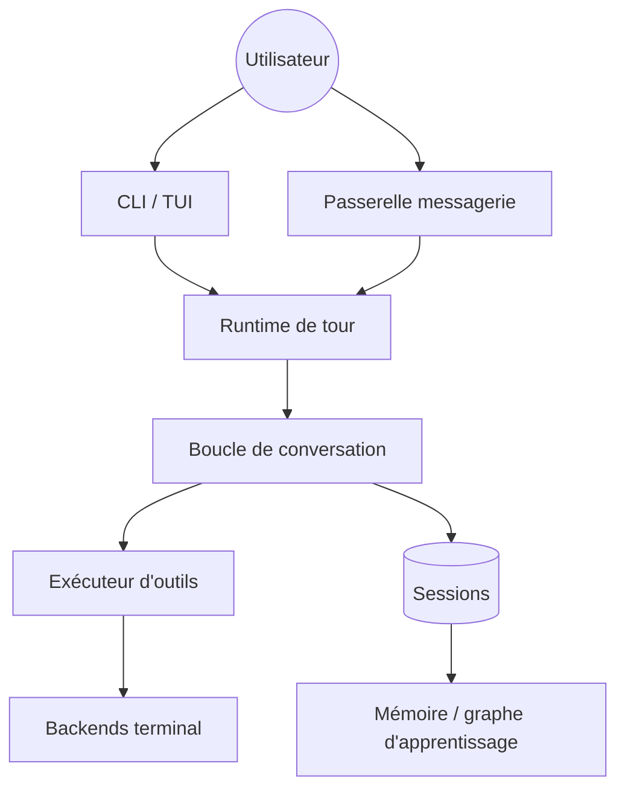

# NousResearch/hermes-agent

> A personal assistant, either on a terminal or via messaging, that can be hosted on a VPS, for independent users.

## The problem
An agent linked to the laptop dies when the laptop is shut down, and restarts each session without any memory.
Moving the laptop to another location and connecting to it from a phone requires you to assemble the necessary hardware and software yourself.

## What it actually does
Complete TUI plus a single gateway to Telegram, Discord, Slack, WhatsApp, Signal, and email.
Create skills from your own executions, review them for use, and search through past sessions.
Seven execution backends: local, Docker, SSH, Singularity, Modal, Daytona, and Vercel Sandbox.
Integrated cron scheduler, isolated sub-agents, and trajectory generation for training.

## How it is wired


## Trying it
```bash
curl -fsSL https://hermes-agent.nousresearch.com/install.sh | bash
hermes
hermes model
hermes doctor
```

## Cost and gotchas
The models are your responsibility (OpenRouter, OpenAI, personal endpoint) or can be accessed through our Nous Portal subscription.

The installer downloads uv, Python 3.11, Node, ripgrep, and ffmpeg; the Windows antivirus program flags `uv.exe`.

## What it is not
Not a managed service: the security of the VPS, cookies, and keys remains your responsibility.
The README does not specify any license – this should be verified before any commercial use.
The learning loop is a heuristic for prompts, not a model training process.

## Alternatives
- `ollama/ollama`: If the need is to run a local model, rather than having a permanent assistant.
- `OpenHands/OpenHands`: Same concept of a self-hosted agent, with a focus on code rather than being an assistant.

## For you
Interesting as a test case for a persistent agent; too young to handle a major production project.
