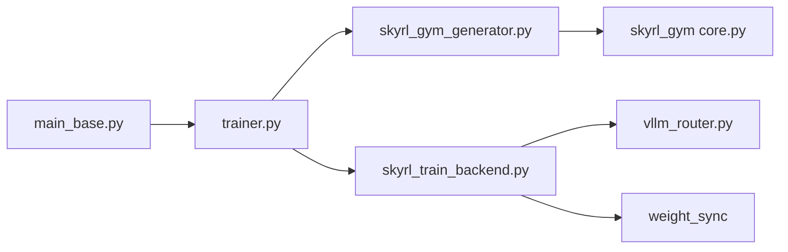

# NovaSky-AI/SkyRL

> Reinforcement learning library for LLMs, from training to environments and agents.

## The problem
Training LLMs with RL requires assembling distributed training, inference for rollouts, environments and weight synchronization.

## What it actually does
Python monorepo: `skyrl` (RL training, SFT, Tinker API compatibility), `skyrl-gym` (math, code, search, SQL environments in a Gymnasium API) and `skyrl-agent` (long-running agents). The trainer relies on FSDP or Megatron, vLLM inference servers and weight synchronization; an asynchronous mode decouples rollouts from training. Ray, PyTorch/CUDA and vLLM are underneath.

## How it is wired


## Trying it
The README provides no command: it points to the getting-started documents (quickstart, Development Guide).
```bash
# aucune commande documentée dans le README
```

## Cost and gotchas
GPU hardware required; installation not detailed in the README. 471 open issues: active repository but in flux.

## What it is not
Not a turnkey solution: it is a training framework for teams that have GPUs. The link with Tinker is an API compatibility, not a service.

## Alternatives
- veRL: cited as a backend of `skyrl-agent`.

## For you
Watch: relevant if you do RL on LLMs with your own GPUs; without a GPU, nothing to take from it.
