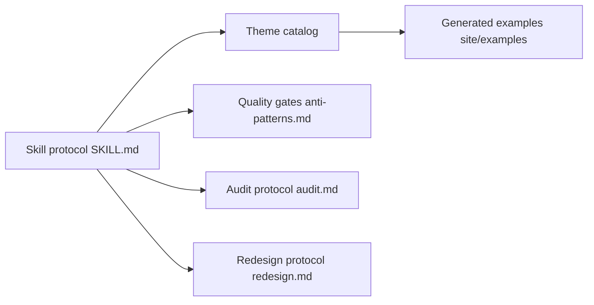

# Nutlope/hallmark

> A design skill for code agents that avoids AI-generated pages.

## The problem
The generated web pages all share the same characteristics: capitalized labels, a highlighted word in the title, and fake forms.

## What it actually does
Skill (Claude Code, Codex, Cursor, OpenCode) offers three themes from a total of 48, and builds the page around the visitor's task, controlling it with `sloplint.mjs --render` in a real eight-column browser, followed by a review by a sub-agent. The "redesign" and "audit" modes, and a "custom" mode without a theme, are also available, along with 755 photos with open licenses. The gates are tiered: Floor, Reflex, Finish.

## How it is wired


## Trying it
```bash
npx skills add nutlope/hallmark -g
node skills/hallmark/scripts/sloplint.mjs <fichier> --render
```

## Cost and gotchas
Node 18+. The browser controls require `npm i -g puppeteer-core` and Chrome. You are responsible for providing the models that run the skill.

## What it is not
This is not a tool for generating mockups from data: the skill only covers HTML/CSS development. The tests in the repository are unit tests, without a backend.

## Alternatives
No alternative is specified in the README.

## For you
Ignore this for your data/AI profile: focused on marketing page design; only keep it if you frequently publish web pages.
