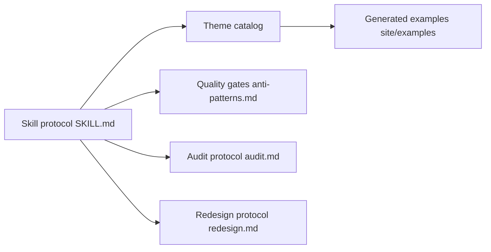

# Nutlope/hallmark

> Skill de design pour agents de code qui évite les pages d'allure générée par IA.

## Le problème
Les modèles produisent des pages web aux mêmes tics : étiquettes en capitales, mot coloré dans le titre, formulaires factices.

## Ce que ça fait vraiment
Skill (Claude Code, Codex, Cursor, OpenCode) qui propose trois thèmes parmi 48, construit la page autour de la tâche du visiteur et la contrôle avec `sloplint.mjs --render` dans un vrai navigateur à huit largeurs, puis une relecture par un sous-agent. Modes `redesign` et `audit`, mode `custom` sans thème, 755 photos sous licence ouverte. Les gates sont étagées : Floor, Reflex, Finish.

## Comment c'est branché


## Essayer
```bash
npx skills add nutlope/hallmark -g
node skills/hallmark/scripts/sloplint.mjs <fichier> --render
```

## Coût et pièges
Node 18+. Les contrôles navigateur demandent `npm i -g puppeteer-core` et Chrome. Les modèles qui exécutent le skill sont à ta charge.

## Ce que ce n'est pas
Pas un générateur de maquettes à partir de données : le skill ne couvre que HTML/CSS autonome. Les tests du dépôt sont des fixtures, sans backend.

## Alternatives
Aucune alternative nommée dans le README.

## Pour toi
À ignorer pour ton profil data/IA : centré sur le design de pages marketing ; garde-le seulement si tu publies souvent des pages web.

