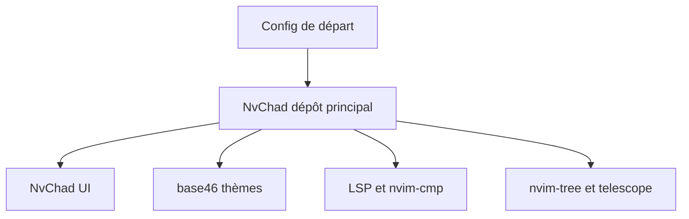

# NvChad/NvChad

> Neovim configuration in Lua with a polished interface and lazy loading, for Neovim users.

## The problem
Configuring Neovim from scratch takes time, and a lightweight editor quickly loses its visual comfort.

## What it actually does
Provides a configuration base: about 90 themes via the base46 plugin, a homemade status line and tab bar, a cheatsheet, nvim-tree, telescope, LSP (nvim-lspconfig, mason), nvim-cmp completion, treesitter, gitsigns. Lazy loading affects 93% of plugins according to the README, with a claimed startup of 0.02 to 0.07 s. The repository is imported as a plugin from a starter configuration.

## How it is wired
Simplified diagram based on the sheet, no diagram provided.

## Trying it
No command documented in the README, which points to the project website for installation.

## Cost and gotchas
Free. Requires Neovim and a starter configuration. The startup times quoted come from the author, on an old Pentium.

## What it is not
It is not a standalone editor, nor a full IDE: it is a configuration layer for Neovim. It does not replace your own config if you want to control everything.

## Alternatives
- doom-emacs and lunarvim: the README cites them as sources of inspiration, without recommending them.

## For you
Watch: handy for editing scripts and configs on servers via Neovim, but of no value for a workflow centered on notebooks or VS Code.
