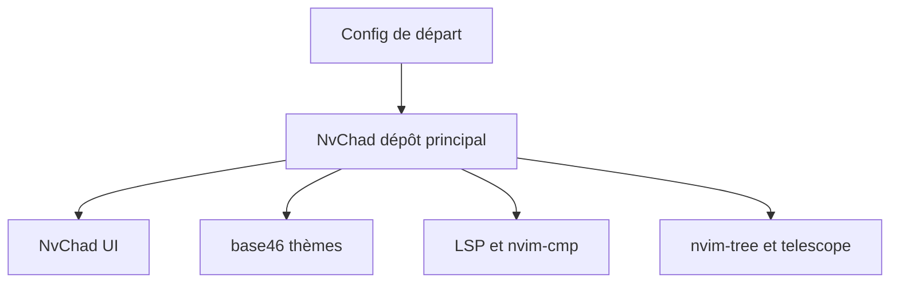

# NvChad/NvChad

> Configuration Neovim en Lua avec interface soignée et chargement différé, pour utilisateurs de Neovim.

## Le problème
Configurer Neovim de zéro prend du temps, et un éditeur léger perd vite son confort visuel.

## Ce que ça fait vraiment
Fournit une base de configuration : environ 90 thèmes via le plugin base46, une ligne d'état et une barre d'onglets maison, une feuille d'aide, nvim-tree, telescope, LSP (nvim-lspconfig, mason), complétion nvim-cmp, treesitter, gitsigns. Le chargement différé touche 93 % des plugins selon le README, avec un démarrage annoncé de 0,02 à 0,07 s. Le dépôt s'importe comme plugin depuis une configuration de départ.

## Comment c'est branché
Schéma simplifié d'après la fiche, sans diagramme fourni.

## Essayer
Aucune commande documentée dans le README, qui renvoie au site du projet pour l'installation.

## Coût et pièges
Gratuit. Il faut Neovim et une configuration de départ (starter). Les temps de démarrage cités viennent de l'auteur, sur un vieux Pentium.

## Ce que ce n'est pas
Ce n'est pas un éditeur autonome, ni un IDE complet : c'est une couche de configuration pour Neovim. Il ne remplace pas ta propre config si tu veux tout maîtriser.

## Alternatives
- doom-emacs et lunarvim : le README les cite comme sources d'inspiration, sans les recommander.

## Pour toi
À surveiller : pratique pour éditer scripts et configs sur serveurs via Neovim, mais sans valeur pour un workflow centré sur notebooks ou VS Code.

