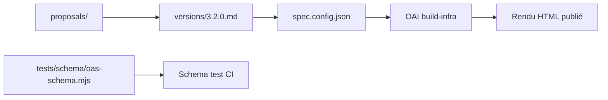

# OAI/OpenAPI-Specification

> Sources of the OpenAPI specification, a standard for describing HTTP APIs, for API designers and tool builders.

## The problem
Without a standard description, each HTTP API documents itself in its own way, which prevents automatic client generation, testing and documentation.

## What it actually does
Repository of the specification, as one Markdown file per version (`versions/3.2.0.md`, `3.1.2.md`, `3.0.4.md`). An OpenAPI document, in YAML or JSON, describes an HTTP service so that humans and machines can understand it. The repository also contains the JSON validation schemas, proposals, the build tooling shared through the `OAI/build-infra` submodule and the governance (technical committee, weekly meetings). No application code.

## How it is wired

## Trying it
No command in the README: read `versions/3.2.0.md` and the listed examples.

## Cost and gotchas
Free. Several versions coexist (3.0, 3.1, 3.2): check which one your tooling supports.

## What it is not
Not a tool nor an implementation: it generates nothing. It does not cover every HTTP API style, and does not replace written documentation.

## Alternatives
No alternative cited in the README.

## For you
Adopt as a reference: essential for describing the API of a served model or a data service, and the basis of most client generators.
