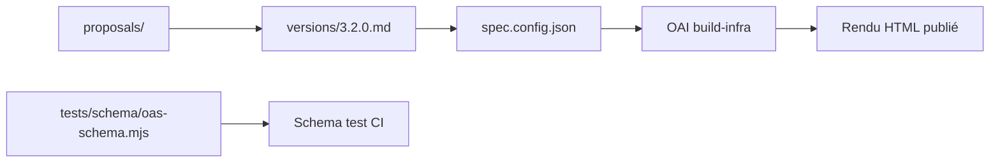

# OAI/OpenAPI-Specification

> Sources de la spécification OpenAPI, standard de description d'API HTTP, pour concepteurs et outilleurs d'API.

## Le problème
Sans description standard, chaque API HTTP se documente à sa façon et empêche génération de clients, tests et documentation automatiques.

## Ce que ça fait vraiment
Dépôt de la spécification, sous forme de Markdown par version (`versions/3.2.0.md`, `3.1.2.md`, `3.0.4.md`). Un document OpenAPI, en YAML ou JSON, décrit un service HTTP afin que humains et machines le comprennent. Le dépôt contient aussi les schémas JSON de validation, des propositions, l'outillage de build partagé via le sous-module `OAI/build-infra` et la gouvernance (comité technique, réunions hebdomadaires). Pas de code applicatif.

## Comment c'est branché

## Essayer
Aucune commande dans le README : lire `versions/3.2.0.md` et les exemples listés.

## Coût et pièges
Gratuit. Plusieurs versions coexistent (3.0, 3.1, 3.2) : vérifier laquelle ton outillage prend en charge.

## Ce que ce n'est pas
Pas un outil ni une implémentation : il ne génère rien. Ne couvre pas tous les styles d'API HTTP, et ne remplace pas une doc rédigée.

## Alternatives
Aucune alternative citée dans le README.

## Pour toi
À adopter comme référence : l'essentiel pour décrire l'API d'un modèle servi ou d'un service de données, et base de la plupart des générateurs de clients.

