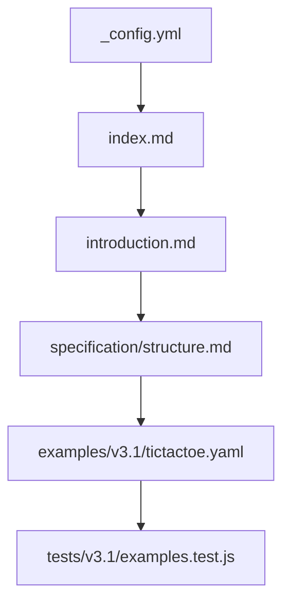

# OAI/learn.openapis.org

> Educational site of the OpenAPI Initiative for learning OpenAPI, Arazzo and Overlay.

## The problem
The OpenAPI specifications are dense; there is no progressive learning path.

## What it actually does
Jekyll site organized by theme (specification, Arazzo, overlay, references). The YAML examples are validated by JavaScript tests. The README is limited to running it locally.

## How it is wired


## Trying it
```bash
# Aucune commande exacte : le README renvoie au Quickstart Jekyll.
```

## Cost and gotchas
Free. Running the site locally requires Jekyll (Ruby), outside the prerequisites list. Content under CC-BY-4.0.

## What it is not
Not the specification itself, nor a tool: a documentation site.

## Alternatives
No alternative named in the README.

## For you
Worth watching: a good base for learning to describe model or service APIs, to read on demand.
