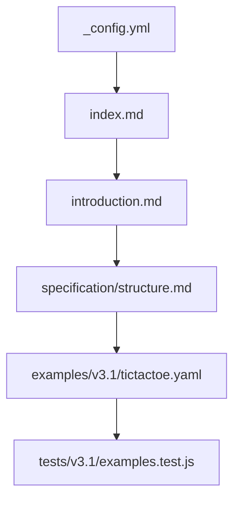

# OAI/learn.openapis.org

> Site pédagogique de l'OpenAPI Initiative pour apprendre OpenAPI, Arazzo et Overlay.

## Le problème
Les spécifications OpenAPI sont denses ; il manque un parcours d'apprentissage progressif.

## Ce que ça fait vraiment
Site Jekyll organisé par thèmes (spécification, Arazzo, overlay, références). Les exemples YAML sont validés par des tests JavaScript. Le README se limite au lancement local.

## Comment c'est branché


## Essayer
```bash
# Aucune commande exacte : le README renvoie au Quickstart Jekyll.
```

## Coût et pièges
Gratuit. Lancer le site en local demande Jekyll (Ruby), hors liste des prérequis. Contenu sous CC-BY-4.0.

## Ce que ce n'est pas
Pas la spécification elle-même, ni un outil : un site de documentation.

## Alternatives
Aucune alternative nommée dans le README.

## Pour toi
À surveiller : bonne base pour apprendre à décrire des API de modèles ou de services, à lire à la demande.

