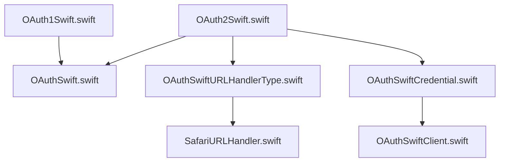

# OAuthSwift/OAuthSwift

> Swift library to authenticate iOS and macOS apps with OAuth 1 and 2.

## The problem
Implementing the OAuth flow (redirects, tokens, request signing) by hand in an Apple app is long and error-prone.

## What it actually does
`OAuth1Swift` and `OAuth2Swift` open the authorization URL through a handler (Safari, ASWebAuthenticationSession or a web view), receive the callback, store the token in `OAuthSwiftCredential`, then sign the client's HTTP requests. PKCE supported; many providers listed.

## How it is wired


## Trying it
Install by dragging `OAuthSwift.xcodeproj` into the Xcode project, then:
```swift
oauthswift = OAuth2Swift(consumerKey: "********", consumerSecret: "********",
    authorizeUrl: "https://api.instagram.com/oauth/authorize", responseType: "token")
```

## Cost and gotchas
Free. Xcode and Swift are required, though absent from the prerequisites list. Last push in May 2024: uncertain upkeep. You must declare a URL scheme and check the source application.

## What it is not
Not an OAuth server, not usable outside the Apple ecosystem. The installation described is manual.

## Alternatives
No alternative cited in the README.

## For you
Ignore: Apple mobile app library, unrelated to a data, AI or MLOps profile.
