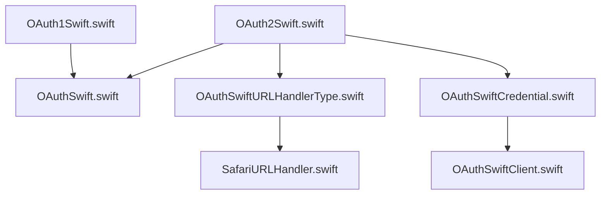

# OAuthSwift/OAuthSwift

> Bibliothèque Swift pour authentifier des applications iOS et macOS en OAuth 1 et 2.

## Le problème
Implémenter le flux OAuth (redirections, jetons, signature des requêtes) à la main dans une app Apple est long et sujet aux erreurs.

## Ce que ça fait vraiment
`OAuth1Swift` et `OAuth2Swift` ouvrent l'URL d'autorisation via un gestionnaire (Safari, ASWebAuthenticationSession ou vue web), reçoivent le rappel, stockent le jeton dans `OAuthSwiftCredential`, puis signent les requêtes HTTP du client. PKCE pris en charge ; nombreux fournisseurs listés.

## Comment c'est branché


## Essayer
Installation en glissant `OAuthSwift.xcodeproj` dans le projet Xcode, puis :
```swift
oauthswift = OAuth2Swift(consumerKey: "********", consumerSecret: "********",
    authorizeUrl: "https://api.instagram.com/oauth/authorize", responseType: "token")
```

## Coût et pièges
Gratuit. Il faut Xcode et Swift, absents de la liste des prérequis. Dernier push en mai 2024 : suivi incertain. Il faut déclarer un schéma d'URL et vérifier l'application source.

## Ce que ce n'est pas
Pas un serveur OAuth, pas utilisable hors écosystème Apple. L'installation décrite est manuelle.

## Alternatives
Aucune alternative citée dans le README.

## Pour toi
Ignorer : bibliothèque d'app mobile Apple, sans lien avec un profil data, IA ou MLOps.

