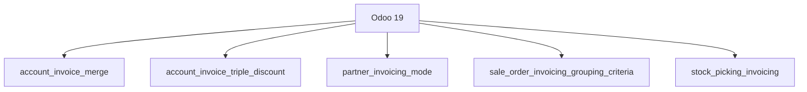

# OCA/account-invoicing

> Community collection of Odoo 19 modules for invoicing: discounts, merging, credit notes, automatic sending.

## The problem
Base Odoo covers few specific invoicing cases (multiple discounts, grouping, transmission modes).

## What it actually does
The repository is a catalog of Odoo addons in version 19.0: `account_invoice_merge`, `account_invoice_triple_discount`, `account_invoice_auto_send_by_email`, `partner_invoicing_mode`, `sale_order_invoicing_grouping_criteria`, etc. Each addon extends the invoice, sales or stock models. The README only gives the table of addons.

## How it is wired
Simplified diagram based on the sheet, no diagram provided.

## Trying it
No command documented in the README (addon table only).

## Cost and gotchas
Assumes an Odoo 19 instance already in place. AGPL-3.0 license: distribution obligations for network use. 234 open issues.

## What it is not
Not a standalone application: these are Odoo extensions, installable only inside it.

## Alternatives
No alternative named in the README.

## For you
Ignore: Odoo accounting, unrelated to data/AI/MLOps work.
