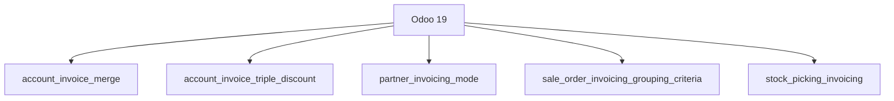

# OCA/account-invoicing

> Collection communautaire de modules Odoo 19 pour la facturation : remises, fusion, avoirs, envoi automatique.

## Le problème
Odoo de base couvre peu les cas de facturation spécifiques (remises multiples, regroupement, modes de transmission).

## Ce que ça fait vraiment
Le dépôt est un catalogue d'addons Odoo en version 19.0 : `account_invoice_merge`, `account_invoice_triple_discount`, `account_invoice_auto_send_by_email`, `partner_invoicing_mode`, `sale_order_invoicing_grouping_criteria`, etc. Chaque addon étend les modèles de facture, de vente ou de stock. Le README ne donne que la table des addons.

## Comment c'est branché
Schéma simplifié d'après la fiche, sans diagramme fourni.

## Essayer
Aucune commande documentée dans le README (table d'addons seulement).

## Coût et pièges
Suppose une instance Odoo 19 déjà en place. Licence AGPL-3.0 : obligations de diffusion en usage réseau. 234 issues ouvertes.

## Ce que ce n'est pas
Pas une application autonome : ce sont des extensions d'Odoo, installables seulement dedans.

## Alternatives
Aucune alternative nommée dans le README.

## Pour toi
Ignorer : de la comptabilité Odoo, sans lien avec un travail data/IA/MLOps.

