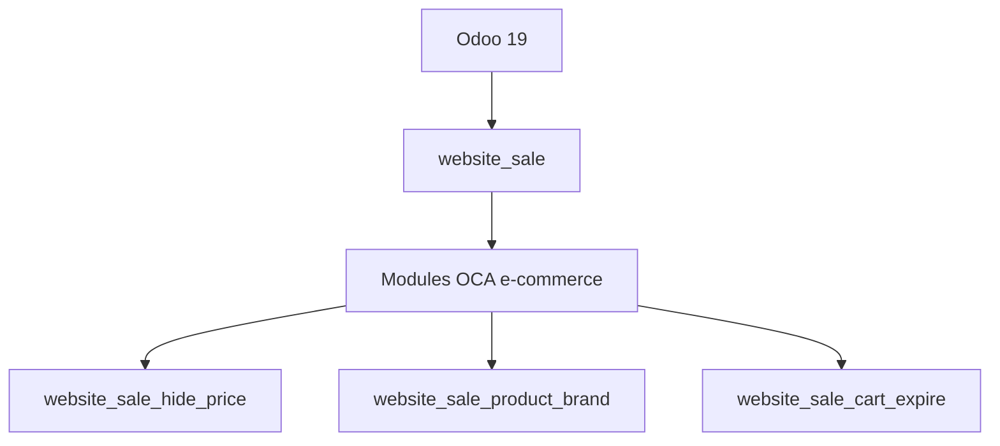

# OCA/e-commerce

> Collection of Odoo 19 modules for the online shop, maintained by the OCA community.

## The problem
Odoo's online sales module lacks many common features (hidden prices, filters, payment, displayed stock).

## What it actually does
The README lists about fifty modules in version 19.0: multiple product links, price hiding, barcode search, cart expiry, payment fees, product matrix, brands, wishlists, secondary units and more. Each module is described in one line.

## How it is wired

Simplified diagram based on the sheet, no diagram provided.

## Trying it
No documented command.

## Cost and gotchas
Free, but you need an Odoo 19 instance already in place. AGPL-3.0 license: obligation to publish the code in case of network service.

## What it is not
Not a standalone shop: these are extensions for Odoo. The README gives neither installation procedure nor usage documentation.

## Alternatives
None named in the README.

## For you
Concerns only those who run Odoo as an online shop: unrelated to data or AI, ignore.
