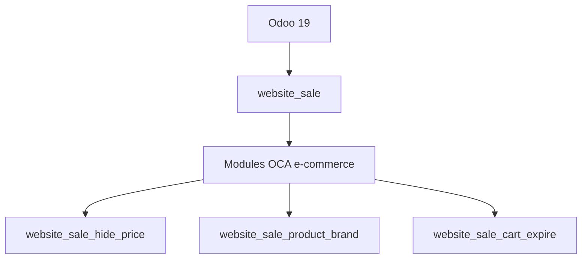

# OCA/e-commerce

> Collection de modules Odoo 19 pour la boutique en ligne, maintenue par la communauté OCA.

## Le problème
Le module de vente en ligne d'Odoo manque de nombreuses fonctions courantes (prix masqués, filtres, paiement, stock affiché).

## Ce que ça fait vraiment
Le README liste une cinquantaine de modules en version 19.0 : liens produits multiples, masquage des prix, recherche par code-barres, expiration des paniers, frais de paiement, matrice de produits, marques, listes de souhaits, unités secondaires et plus. Chaque module se décrit en une ligne.

## Comment c'est branché

Schéma simplifié d'après la fiche, sans diagramme fourni.

## Essayer
Aucune commande documentée.

## Coût et pièges
Gratuit, mais il faut une instance Odoo 19 déjà en place. Licence AGPL-3.0 : obligations de publication du code en cas de service réseau.

## Ce que ce n'est pas
Pas une boutique autonome : ce sont des extensions pour Odoo. Le README ne donne ni procédure d'installation ni documentation d'usage.

## Alternatives
Aucune nommée dans le README.

## Pour toi
Concerne seulement ceux qui exploitent Odoo en boutique en ligne : sans lien avec data ou IA, à ignorer.

