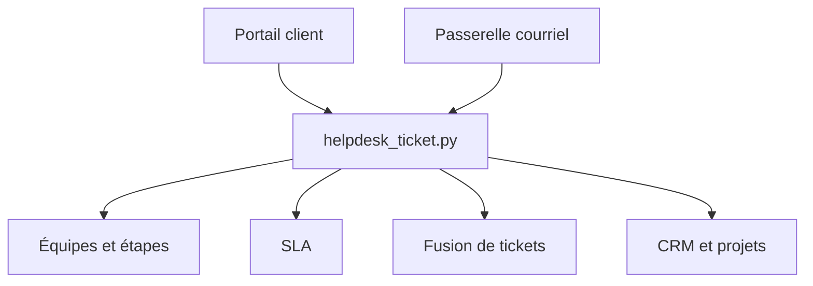

# OCA/helpdesk

> OCA suite of Odoo modules for managing support tickets, from intake to resolution.

## The problem
Tracking customer requests by email or portal, with teams, stages and deadlines, calls for a dedicated tool inside Odoo.

## What it actually does
The base module receives tickets through the portal or the email gateway and assigns them by team and stage. Additional modules add SLAs, ticket merging, closing of inactive tickets, customer rating, and links to CRM, projects, sales, products and field service.

## How it is wired

## Trying it
No command documented in the README, which only contains the table of modules at version 19.0.

## Cost and gotchas
Free, assumes an Odoo 19 instance. AGPL-3.0 license, 73 open issues.

## What it is not
Not an online support service: extensions to install in your own Odoo.

## Alternatives
No alternative named in the README.

## For you
Ignore: an Odoo ticket manager, with no link to data, AI or MLOps work.
