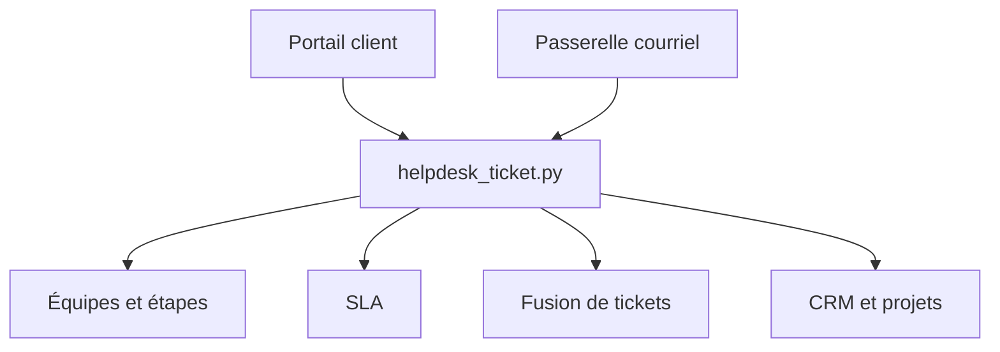

# OCA/helpdesk

> Suite de modules Odoo de l'OCA pour gérer des tickets d'assistance, de la saisie à la résolution.

## Le problème
Suivre les demandes clients par courriel ou portail, avec équipes, étapes et délais, demande un outil dédié dans Odoo.

## Ce que ça fait vraiment
Le module de base reçoit les tickets via le portail ou la passerelle courriel, les assigne par équipe et étape. Des modules ajoutent SLA, fusion de tickets, clôture des tickets inactifs, notation client, liens vers CRM, projets, ventes, produits et service terrain.

## Comment c'est branché

## Essayer
Aucune commande documentée dans le README, qui ne contient que le tableau des modules en version 19.0.

## Coût et pièges
Gratuit, suppose une instance Odoo 19. Licence AGPL-3.0, 73 issues ouvertes.

## Ce que ce n'est pas
Pas un service de support en ligne : des extensions à installer dans ton propre Odoo.

## Alternatives
Aucune alternative nommée dans le README.

## Pour toi
À ignorer : un gestionnaire de tickets Odoo, sans lien avec un travail data, IA ou MLOps.

