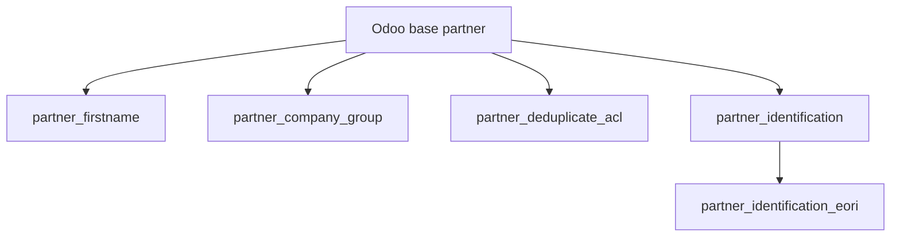

# OCA/partner-contact

> OCA collection of Odoo 19 modules to enrich contact and partner records.

## The problem
Default Odoo contacts lack fields and rules: company groups, deduplication, identifiers, gender, titles.

## What it actually does
The README contains only a table of about sixty modules in version 19.0: company groups, postal codes and NUTS regions, contact deduplication, email validation, partner relationships, lifecycle stages, EORI and GLN identifiers. Detailed operation is undocumented.

## How it is wired
Simplified diagram based on the sheet, no diagram provided.

## Trying it
No command documented in the README.

## Cost and gotchas
Free, but assumes an Odoo 19 instance and manual module deployment. AGPL-3.0 license, with 166 open issues.

## What it is not
Not a standalone application: these are Odoo extensions.

## Alternatives
No alternative named in the README.

## For you
Ignore: ERP modules for Odoo, unrelated to data, AI or MLOps work.
