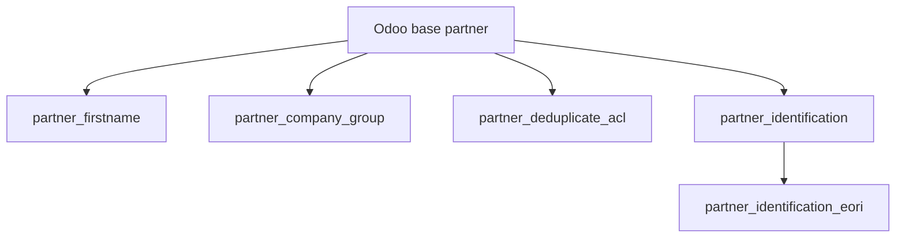

# OCA/partner-contact

> Collection de modules Odoo 19 de l'OCA pour enrichir les fiches contacts et partenaires.

## Le problème
Les contacts Odoo par défaut manquent de champs et de règles : groupes de sociétés, déduplication, identifiants, genre, titres.

## Ce que ça fait vraiment
Le README ne contient qu'un tableau d'une soixantaine de modules en version 19.0 : groupes de sociétés, codes postaux et régions NUTS, déduplication de contacts, validation des courriels, relations entre partenaires, étapes de cycle de vie, identifiants EORI et GLN. Le fonctionnement détaillé est non documenté.

## Comment c'est branché
Schéma simplifié d'après la fiche, sans diagramme fourni.

## Essayer
Aucune commande documentée dans le README.

## Coût et pièges
Gratuit, mais suppose une instance Odoo 19 et un déploiement de modules à la main. Licence AGPL-3.0, avec 166 issues ouvertes.

## Ce que ce n'est pas
Pas une application autonome : ce sont des extensions d'Odoo.

## Alternatives
Aucune alternative nommée dans le README.

## Pour toi
À ignorer : des modules ERP pour Odoo, sans lien avec un travail data, IA ou MLOps.

