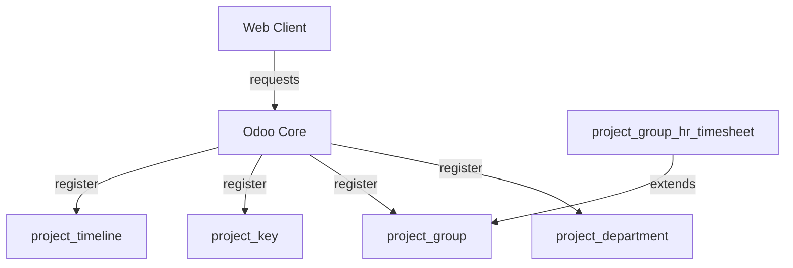

# OCA/project

> Collection of Odoo add-on modules to extend project management, for teams that use Odoo.

## The problem
The base Odoo project module lacks project keys, departments, task templates or roles.

## What it actually does
The repository gathers dozens of independent Python/XML addons (version 19.0 in the README table). Each adds one feature: department, project key, project parent, description templates, stages, timeline view, link to timesheets. They register with Odoo through their manifest.

## How it is wired

## Trying it
No command documented in the README: it only contains the table of available addons.

## Cost and gotchas
Free, but you need a working Odoo instance and the matching version (19.0 in the table). AGPL-3.0 license: code-sharing obligations in case of network service.

## What it is not
Not a standalone application: without Odoo, nothing runs. Not a data science or AI tool.

## Alternatives
No alternative named in the README.

## For you
Ignore for a data / AI / MLOps profile, unless your organization runs Odoo: these are plugins for an ERP, unrelated to your tools.
