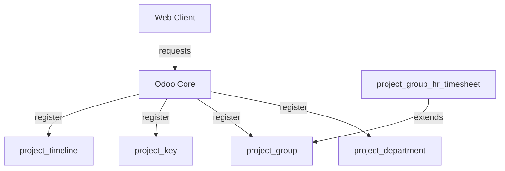

# OCA/project

> Collection de modules complémentaires Odoo pour étendre la gestion de projets, pour les équipes qui utilisent Odoo.

## Le problème
Le module projet d'Odoo de base manque de clés de projet, de départements, de modèles de tâches ou de rôles.

## Ce que ça fait vraiment
Le dépôt réunit des dizaines d'addons Python/XML indépendants (version 19.0 dans le tableau du README). Chacun ajoute une fonction : département, clé de projet, parent de projet, modèles de description, étapes, vue chronologique, rattachement aux feuilles de temps. Ils s'enregistrent auprès d'Odoo par leur manifeste.

## Comment c'est branché

## Essayer
Aucune commande documentée dans le README : il ne contient que le tableau des addons disponibles.

## Coût et pièges
Gratuit, mais il faut une instance Odoo en état de marche et la version qui correspond (19.0 dans le tableau). Licence AGPL-3.0 : obligations de partage du code en cas de service réseau.

## Ce que ce n'est pas
Ce n'est pas une application autonome : sans Odoo, rien ne tourne. Ce n'est pas un outil de data science ou d'IA.

## Alternatives
Aucune alternative nommée dans le README.

## Pour toi
À ignorer pour un profil data / IA / MLOps, sauf si ton organisation exploite Odoo : ce sont des greffons d'un ERP, sans lien avec tes outils.

