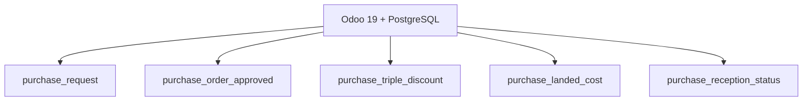

# OCA/purchase-workflow

> Community collection of Odoo 19 modules for purchasing: requests, approval, discounts, receipt.

## The problem
Odoo's purchasing lacks common options: purchase requests, order types, receipt statuses, discounts.

## What it actually does
A catalog of Odoo 19.0 addons: `purchase_request`, `purchase_order_approved`, `purchase_triple_discount`, `purchase_landed_cost`, `purchase_reception_status`, `purchase_order_type`, etc. Each extends `purchase.order`, its lines, stock moves or the partner. Only the addon table appears in the README.

## How it is wired
Simplified diagram based on the sheet, no diagram provided.

## Trying it
No command documented in the README (addon table only).

## Cost and gotchas
Assumes an Odoo 19 instance. AGPL-3.0 license: distribution obligations for network use. 217 open issues.

## What it is not
Not a standalone application: these are Odoo extensions.

## Alternatives
No alternative named in the README.

## For you
Ignore: purchasing ERP unrelated to data/AI/MLOps.
