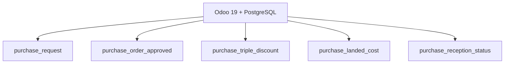

# OCA/purchase-workflow

> Collection communautaire de modules Odoo 19 pour les achats : demandes, approbation, remises, réception.

## Le problème
Les achats d'Odoo manquent d'options courantes : demandes d'achat, types de commande, statuts de réception, remises.

## Ce que ça fait vraiment
Catalogue d'addons Odoo 19.0 : `purchase_request`, `purchase_order_approved`, `purchase_triple_discount`, `purchase_landed_cost`, `purchase_reception_status`, `purchase_order_type`, etc. Chacun étend `purchase.order`, les lignes, les mouvements de stock ou le partenaire. Seule la table d'addons figure au README.

## Comment c'est branché
Schéma simplifié d'après la fiche, sans diagramme fourni.

## Essayer
Aucune commande documentée dans le README (table d'addons seulement).

## Coût et pièges
Suppose une instance Odoo 19. Licence AGPL-3.0 : obligations de diffusion en usage réseau. 217 issues ouvertes.

## Ce que ce n'est pas
Pas une application autonome : ce sont des extensions d'Odoo.

## Alternatives
Aucune alternative nommée dans le README.

## Pour toi
Ignorer : ERP achats sans rapport avec data/IA/MLOps.

