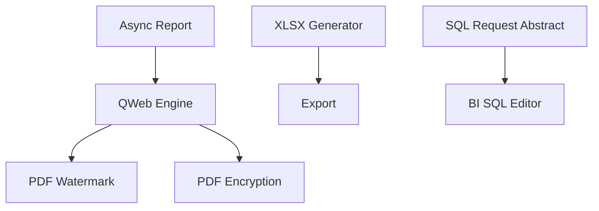

# OCA/reporting-engine

> Collection of Odoo modules (version 19.0) for producing PDF, CSV, XLSX, XML reports and BI views.

## The problem
Odoo's core reporting engine does not cover the formats, asynchronous processing or SQL views that businesses require.

## What it actually does
The README lists 24 modules: `report_xlsx`, `report_csv`, `report_xml`, `report_py3o` (LibreOffice), `report_async`, `report_qweb_encrypt`, `report_qweb_pdf_watermark`, `bi_sql_editor`, `kpi`, `sql_request_abstract`. The provided diagram is a design proposal, not derived from the code, and cites modules (`bi_view_editor`, `sql_export`) absent from the list.

## How it is wired


## Trying it
```bash
# Aucune commande documentée dans le README : installer les modules dans une instance Odoo.
```

## Cost and gotchas
Requires an Odoo 19 instance. `report_py3o` assumes LibreOffice, `report_wkhtmltopdf_param` wkhtmltopdf. AGPL-3.0 license.

## What it is not
Not a standalone BI tool or dashboarding independent of Odoo.

## Alternatives
No alternative named in the README.

## For you
Ignore: only useful if you administer Odoo; the provided diagram is speculative.
