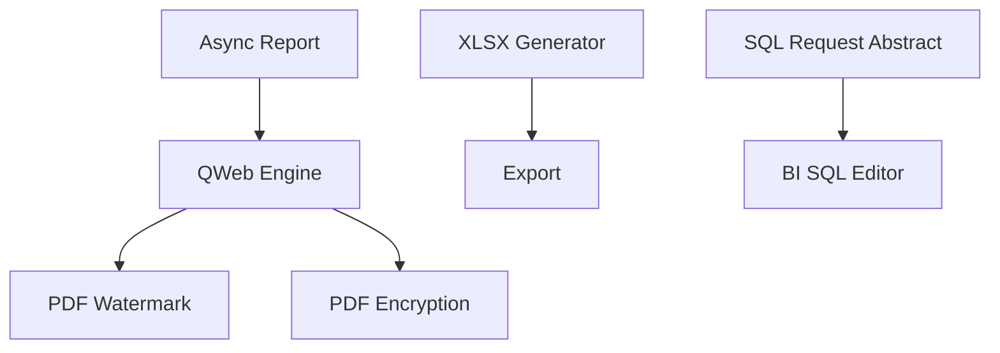

# OCA/reporting-engine

> Collection de modules Odoo (version 19.0) pour produire des rapports PDF, CSV, XLSX, XML et vues BI.

## Le problème
Le moteur de rapports d'Odoo de base ne couvre pas les formats, l'asynchrone ni les vues SQL demandés par les entreprises.

## Ce que ça fait vraiment
Le README liste 24 modules : `report_xlsx`, `report_csv`, `report_xml`, `report_py3o` (LibreOffice), `report_async`, `report_qweb_encrypt`, `report_qweb_pdf_watermark`, `bi_sql_editor`, `kpi`, `sql_request_abstract`. Le schéma fourni est une proposition de conception, non tirée du code, et cite des modules (`bi_view_editor`, `sql_export`) absents de la liste.

## Comment c'est branché


## Essayer
```bash
# Aucune commande documentée dans le README : installer les modules dans une instance Odoo.
```

## Coût et pièges
Exige une instance Odoo 19. `report_py3o` suppose LibreOffice, `report_wkhtmltopdf_param` wkhtmltopdf. Licence AGPL-3.0.

## Ce que ce n'est pas
Pas un outil de BI autonome ni de dashboarding indépendant d'Odoo.

## Alternatives
Aucune alternative nommée dans le README.

## Pour toi
Ignorer : utile seulement si tu administres Odoo ; le diagramme fourni est spéculatif.

