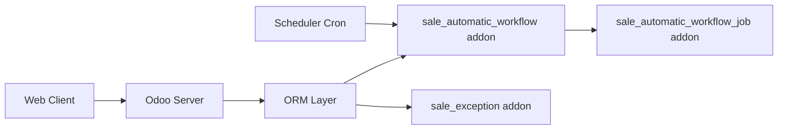

# OCA/sale-workflow

> Collection of Odoo 19 add-on modules for the sales workflow, maintained by the OCA.

## The problem
The standard Odoo sales module lacks many variants that companies ask for (discounts, blocks, quotation revisions, portal).

## What it actually does
The repository contains about 90 Odoo addons, each adding a feature to sales orders: automatic workflow, fixed or global discounts, invoicing or delivery blocking, quotation revisions, order types, wishlists, product recommendations, customer portal extensions. Each addon extends the `sale.order` models and their views.

## How it is wired

## Trying it
No command documented: the README only contains the list of addons and their versions.

## Cost and gotchas
Free, but requires an Odoo 19 instance. Some addons depend on `queue_job`. 309 open issues.

## What it is not
Not a standalone application: these are Odoo extensions. Under the AGPL-3.0 license (network copyleft).

## Alternatives
The README names no alternative.

## For you
Ignore: a sales ERP unrelated to data or AI, useful only if you administer an Odoo.
