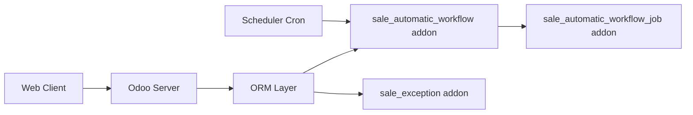

# OCA/sale-workflow

> Collection de modules complémentaires Odoo 19 pour le flux de ventes, maintenue par l'OCA.

## Le problème
Le module de ventes standard d'Odoo manque de nombreuses variantes demandées par les entreprises (remises, blocages, révisions de devis, portail).

## Ce que ça fait vraiment
Le dépôt contient environ 90 addons Odoo, chacun ajoutant une fonction aux commandes de vente : workflow automatique, remises fixes ou globales, blocage de facturation ou de livraison, révisions de devis, types de commande, listes de souhaits, recommandations de produits, extensions du portail client. Chaque addon étend les modèles `sale.order` et ses vues.

## Comment c'est branché

## Essayer
Aucune commande documentée : le README ne contient que la liste des addons et leurs versions.

## Coût et pièges
Gratuit, mais nécessite une instance Odoo 19. Quelques addons dépendent de `queue_job`. 309 issues ouvertes.

## Ce que ce n'est pas
Pas une application autonome : ce sont des extensions d'Odoo. Sous licence AGPL-3.0 (copyleft réseau).

## Alternatives
Le README ne nomme pas d'alternative.

## Pour toi
Ignorer : ERP de ventes sans rapport avec la data ou l'IA, utile seulement si tu administres un Odoo.

