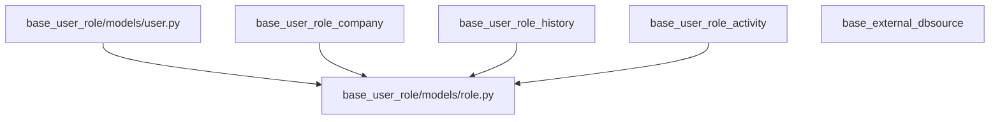

# OCA/server-backend

> Collection of Odoo 19 modules: user roles, external data sources, global discounts.

## The problem
Stock Odoo handles reusable user roles and access to external databases poorly.

## What it actually does
The README contains only the module list: `base_user_role` (and its per-company, history and activity extensions), `base_external_dbsource`, `base_global_discount` and `server_action_navigate`. The three role extensions build on `base_user_role`; the others are independent.

## How it is wired
Diagram based on the code.



## Trying it
```bash
# Aucune commande documentée dans le README
```

## Cost and gotchas
Free. An Odoo 19 instance is required. AGPL-3.0 license (strong copyleft).

## What it is not
Not a standalone application: modules to add to Odoo.

## Alternatives
None mentioned in the README.

## For you
Ignore: Odoo administration modules, outside the data / AI / MLOps scope.
