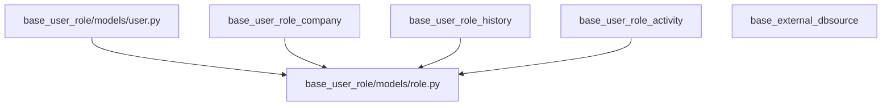

# OCA/server-backend

> Collection de modules Odoo 19 : rôles utilisateurs, sources de données externes, remises globales.

## Le problème
Odoo de base gère mal les rôles utilisateurs réutilisables et l'accès à des bases externes.

## Ce que ça fait vraiment
Le README ne contient que la liste des modules : `base_user_role` (et ses extensions par société, historique et activité), `base_external_dbsource`, `base_global_discount` et `server_action_navigate`. Les trois extensions de rôles s'appuient sur `base_user_role` ; les autres sont indépendants.

## Comment c'est branché
Schéma d'après le diagramme du code.



## Essayer
```bash
# Aucune commande documentée dans le README
```

## Coût et pièges
Gratuit. Une instance Odoo 19 est nécessaire. Licence AGPL-3.0 (copyleft fort).

## Ce que ce n'est pas
Pas une application autonome : des modules à ajouter à Odoo.

## Alternatives
Aucune citée dans le README.

## Pour toi
Ignorer : modules d'administration Odoo, hors du champ data / IA / MLOps.

