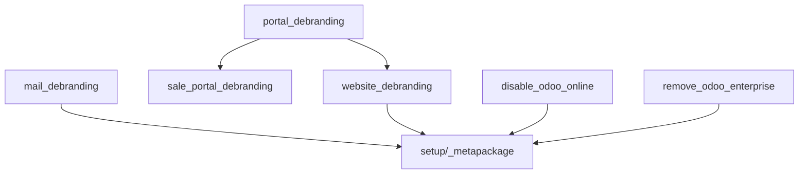

# OCA/server-brand

> Odoo 19 modules that remove the Odoo branding from emails, the portal and the website.

## The problem
Odoo instances display the brand and links to odoo.com everywhere, which gets in the way of a customized version.

## What it actually does
Six addons: disable_odoo_online, mail_debranding, portal_debranding, remove_odoo_enterprise, sale_portal_debranding, website_debranding. A metapackage assembles them. Two modules cut the links to odoo.com and to the enterprise modules.

## How it is wired


## Trying it
```bash
# Aucune commande documentée : installer les addons dans une instance Odoo
```

## Cost and gotchas
An Odoo 19 instance is required. AGPL-3.0: modifications served over a network must remain open.

## What it is not
Not a data tool. Removing the enterprise modules is your responsibility with regard to Odoo's terms.

## Alternatives
- No alternative named in the README.

## For you
Ignore: Odoo customization, unrelated to data / AI / MLOps.
