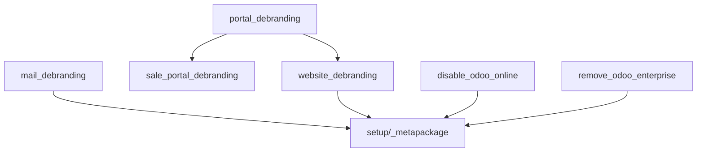

# OCA/server-brand

> Modules Odoo 19 qui retirent la marque Odoo des courriels, du portail et du site web.

## Le problème
Les instances Odoo affichent la marque et des liens vers odoo.com partout, ce qui gêne une version personnalisée.

## Ce que ça fait vraiment
Six addons : disable_odoo_online, mail_debranding, portal_debranding, remove_odoo_enterprise, sale_portal_debranding, website_debranding. Un métapaquet les assemble. Deux modules coupent les liens vers odoo.com et vers les modules enterprise.

## Comment c'est branché


## Essayer
```bash
# Aucune commande documentée : installer les addons dans une instance Odoo
```

## Coût et pièges
Il faut une instance Odoo 19. AGPL-3.0 : les modifications servies en réseau doivent rester ouvertes.

## Ce que ce n'est pas
Pas un outil de données. Retirer les modules enterprise relève de ta responsabilité vis-à-vis des conditions d'Odoo.

## Alternatives
- Aucune alternative nommée dans le README.

## Pour toi
Ignorer : de la personnalisation d'Odoo, sans lien avec data / IA / MLOps.

