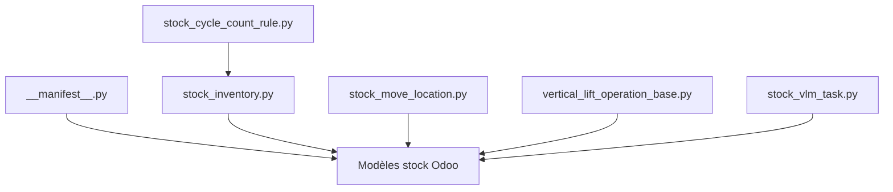

# OCA/stock-logistics-warehouse

> Odoo modules that add fields and buttons to stock, warehouse and lot objects, for Odoo users.

## The problem
Base Odoo stock lacks fine-grained inventory tracking, location locking and vertical-store integrations.

## What it actually does
Each addon extends the stock, warehouse, location, move or lot models additively, without changing the flows. It includes cycle counting, inventory variance, location locking, bulk moves, a lot catalog, and vertical lift adapters (Kardex, Modula).

## How it is wired

## Trying it
No documented command: the README lists the addons and points to other logistics repositories.

## Cost and gotchas
Free, but you need an Odoo instance at the repository's version; the table says 19.0 while the architecture mentions 18.0. AGPL-3.0 license.

## What it is not
It is not a standalone WMS or an application: these are add-ons that do not change Odoo's processes.

## Alternatives
No alternative named in the README.

## For you
Ignore: only useful if you administer a logistics Odoo, outside your data / MLOps scope.
