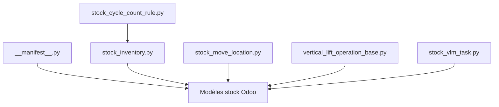

# OCA/stock-logistics-warehouse

> Modules Odoo qui ajoutent champs et boutons aux objets de stock, d'entrepôt et de lots, pour les utilisateurs d'Odoo.

## Le problème
Le stock d'Odoo de base manque de suivi d'inventaire fin, de verrouillage d'emplacements et d'intégrations de magasins verticaux.

## Ce que ça fait vraiment
Chaque addon étend les modèles stock, entrepôt, emplacement, mouvement ou lot de manière additive, sans changer les flux. On y trouve le comptage cyclique, l'écart d'inventaire, le verrouillage d'emplacements, le déplacement en masse, un catalogue de lots, et des adaptateurs de lifts verticaux (Kardex, Modula).

## Comment c'est branché

## Essayer
Aucune commande documentée : le README liste les addons et renvoie vers d'autres dépôts logistiques.

## Coût et pièges
Gratuit mais il faut une instance Odoo à la version du dépôt ; le tableau indique 19.0 alors que l'architecture mentionne 18.0. Licence AGPL-3.0.

## Ce que ce n'est pas
Ce n'est pas un WMS autonome ni une application : ce sont des greffons qui ne changent pas les processus d'Odoo.

## Alternatives
Aucune alternative nommée dans le README.

## Pour toi
À ignorer : utile seulement si tu administres un Odoo logistique, hors de ton périmètre data / MLOps.

