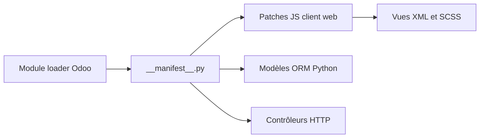

# OCA/web

> Collection of Odoo 18 add-ons that improve the web interface: themes, widgets, views, notifications.

## The problem
Odoo's standard interface lacks small everyday features (dark mode, remembered columns, clickable links).

## What it actually does
The README is a table of some sixty `web_*` modules (dark mode, timeline, computed pivot, chatter, PWA, idle session closing, export restriction). Each module is an independent add-on with its manifest, Python code, XML views and JS/SCSS assets.

## How it is wired

## Trying it
No command documented in the README.

## Cost and gotchas
An Odoo 18 instance is required: each add-on's version starts with 18.0. AGPL-3.0. Some bundle JS libraries (vis-timeline, d3, fuse). 266 open issues.

## What it is not
It is not an application: each module is installed separately in Odoo.

## Alternatives
No alternative named in the README.

## For you
Ignore: Odoo ergonomics, unrelated to a data or AI workflow, unless Odoo is your ERP.
