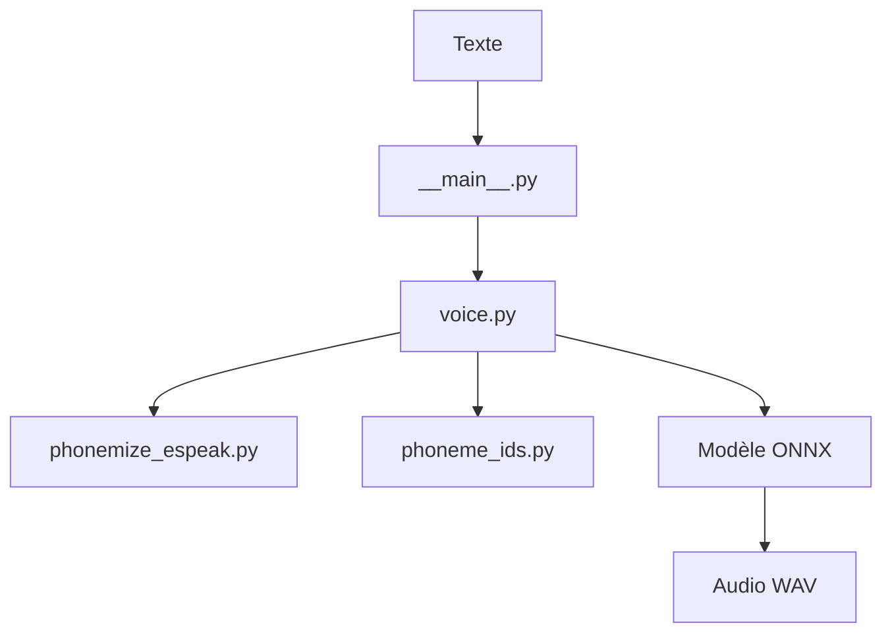

# OHF-Voice/piper1-gpl

> Fast local neural text-to-speech engine, usable from Python, C/C++ or the command line.

## The problem
Quality synthetic voices often go through a paid cloud service, or are too heavy to run locally.

## What it actually does
Takes text, converts it to phonemes via espeak-ng, then to identifiers, and runs an ONNX voice model to produce audio. Exposes a CLI, an HTTP server, a Python API and a C/C++ API. A training component (VITS) lets you create new voices and export them to ONNX.

## How it is wired


## Trying it
```bash
pip install piper-tts
```

## Cost and gotchas
Free, local, no GPU required by the README. The repo is looking for maintainers (call from the Open Home Foundation): its future is not guaranteed. 152 open issues.

## What it is not
Not a hosted service: you download the voices yourself. GPL-3.0 license, restrictive if you embed it in a closed product. The README gives neither latency measurements nor comparisons.

## Alternatives
No alternative named in the README.

## For you
Adopt for local voice (assistants, accessibility): one-line install, but check the GPL before embedding it.
