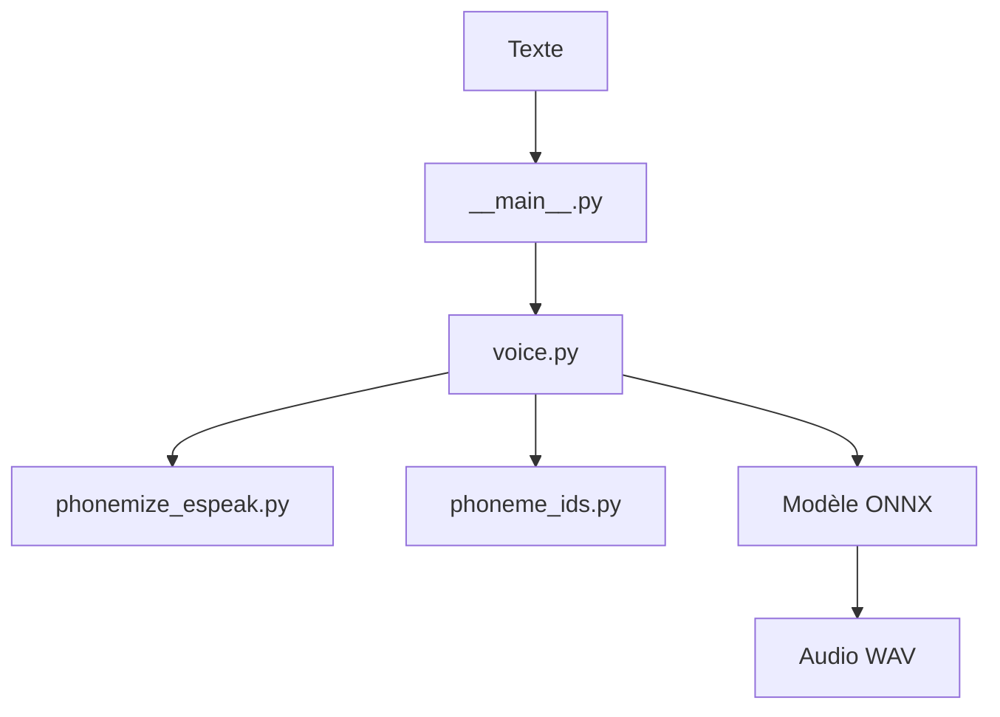

# OHF-Voice/piper1-gpl

> Moteur de synthèse vocale neuronal local, rapide, utilisable en Python, C/C++ ou en ligne de commande.

## Le problème
Les voix de synthèse de qualité passent souvent par un service cloud payant, ou sont trop lourdes pour tourner localement.

## Ce que ça fait vraiment
Prend du texte, le convertit en phonèmes via espeak-ng, puis en identifiants, et fait tourner un modèle de voix ONNX pour produire de l'audio. Expose une CLI, un serveur HTTP, une API Python et une API C/C++. Un volet d'entraînement (VITS) permet de créer de nouvelles voix et de les exporter en ONNX.

## Comment c'est branché


## Essayer
```bash
pip install piper-tts
```

## Coût et pièges
Gratuit, local, sans GPU exigé par le README. Le dépôt cherche des mainteneurs (appel de l'Open Home Foundation) : la suite n'est pas garantie. 152 issues ouvertes.

## Ce que ce n'est pas
Pas un service hébergé : tu télécharges les voix toi-même. Licence GPL-3.0, contraignante si tu l'intègres à un produit fermé. Le README ne donne ni mesure de latence ni comparaison.

## Alternatives
Aucune alternative nommée dans le README.

## Pour toi
À adopter pour de la voix locale (assistants, accessibilité) : installation d'une ligne, mais vérifie la GPL avant de l'embarquer.

