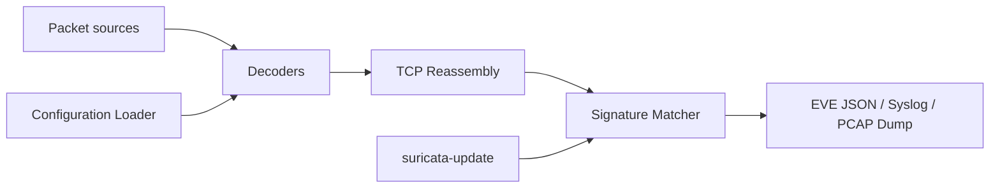

# OISF/suricata

> Network IDS/IPS and NSM engine for security teams and network operators.

## The problem
Detecting intrusions and anomalies in high-throughput network traffic.

## What it actually does
Packet capture (AF_PACKET, DPDK, XDP, NFQ, Netmap, pcap), L2 to L7 decoding, TCP reassembly, signature and anomaly detection, EVE JSON logs. Core in C with Rust for some analyzers, C and Rust plugins, suricata-update for rules, `suricatasc` console. The README mostly describes quality control of contributions and requires a contributor license agreement (CLA).

## How it is wired


## Trying it
The README gives no installation command; it points to the Installation Guide.

```bash
# non documenté dans le README : voir le guide d'installation
```

## Cost and gotchas
Free; requires network hardware and fine tuning. CLA mandatory to contribute.

## What it is not
Not a SIEM: it produces alerts and logs.

## Alternatives
No alternative named in the README.

## For you
Worth watching: useful for feeding detection models with EVE logs; outside your core field otherwise.
