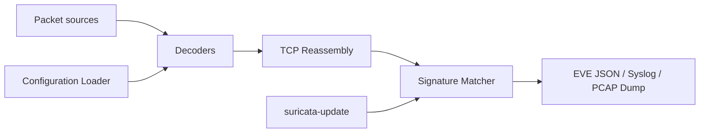

# OISF/suricata

> Moteur IDS/IPS et NSM réseau pour équipes sécurité et opérateurs réseau.

## Le problème
Détecter intrusions et anomalies sur du trafic réseau à haut débit.

## Ce que ça fait vraiment
Capture de paquets (AF_PACKET, DPDK, XDP, NFQ, Netmap, pcap), décodage L2 à L7, réassemblage TCP, détection par signatures et anomalies, journaux EVE JSON. Cœur en C avec Rust pour certains analyseurs, plugins C et Rust, suricata-update pour les règles, console `suricatasc`. Le README décrit surtout le contrôle qualité des contributions et exige un accord de licence de contributeur (CLA).

## Comment c'est branché


## Essayer
Le README ne donne pas de commande d'installation ; renvoie au Guide d'installation.

```bash
# non documenté dans le README : voir le guide d'installation
```

## Coût et pièges
Gratuit ; demande du matériel réseau et un réglage fin. CLA obligatoire pour contribuer.

## Ce que ce n'est pas
Pas un SIEM : il produit des alertes et des journaux.

## Alternatives
Aucune alternative nommée dans le README.

## Pour toi
À surveiller : utile pour alimenter des modèles de détection en journaux EVE ; hors cœur de métier sinon.

