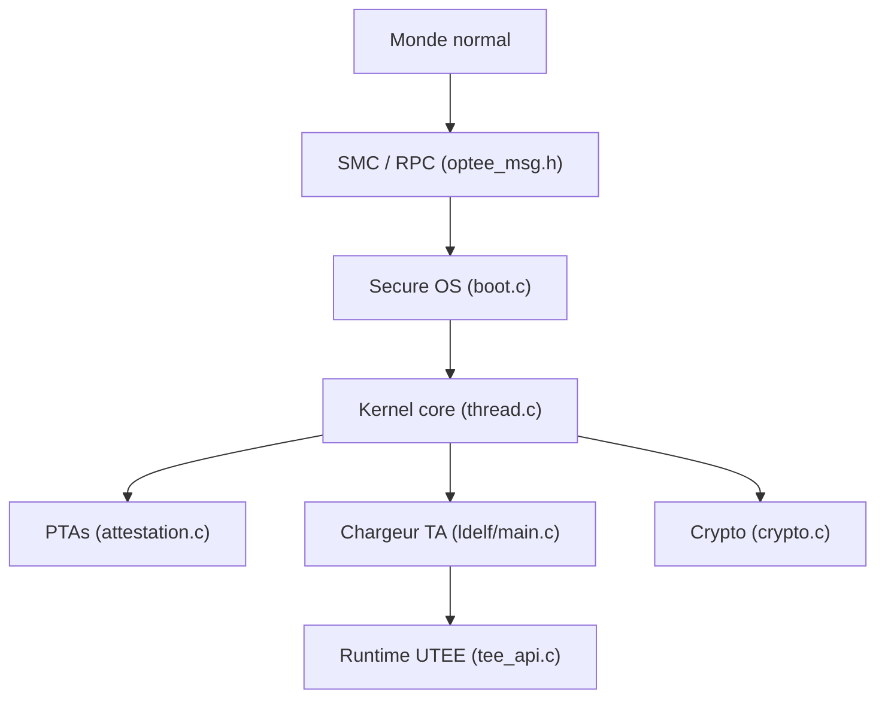

# OP-TEE/optee_os

> Trusted operating system, secure-world side, for ARM and RISC-V processors.

## The problem
Secrets and keys must run in an environment isolated from the main system, otherwise an OS flaw exposes them.

## What it actually does
It is the secure kernel of OP-TEE: it receives calls from the normal world (SMC, FF-A, RPC), runs trusted applications in user mode and provides secure storage, cryptography and attestation. One directory per platform adapts everything to the boards.

## How it is wired


## Trying it
```bash
# Aucune commande documentée dans le README : la documentation a déménagé sur optee.readthedocs.io.
```

## Cost and gotchas
Free, but you need a compatible board, a cross-compilation toolchain and a platform-specific signing flow. License present but not identified by GitHub.

## What it is not
Not an installable product: it is a firmware component to integrate into a SoC. The README contains almost nothing, everything is in the external documentation.

## Alternatives
No alternative named in the README.

## For you
Ignore: secure firmware for embedded boards, unrelated to data, AI or MLOps work.
