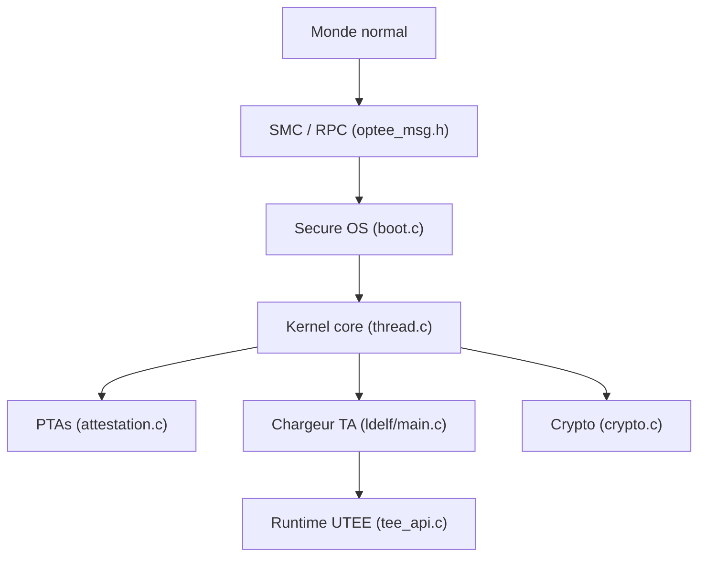

# OP-TEE/optee_os

> Système d'exploitation de confiance, côté monde sécurisé, pour processeurs ARM et RISC-V.

## Le problème
Les secrets et les clés doivent tourner dans un environnement isolé du système principal, sinon une faille de l'OS les expose.

## Ce que ça fait vraiment
C'est le noyau sécurisé d'OP-TEE : il reçoit les appels du monde normal (SMC, FF-A, RPC), exécute des applications de confiance en mode utilisateur et fournit stockage sécurisé, cryptographie et attestation. Un répertoire par plateforme adapte le tout aux cartes.

## Comment c'est branché


## Essayer
```bash
# Aucune commande documentée dans le README : la documentation a déménagé sur optee.readthedocs.io.
```

## Coût et pièges
Gratuit, mais il faut une carte compatible, une chaîne de compilation croisée et un flux de signature propre à la plateforme. Licence présente mais non identifiée par GitHub.

## Ce que ce n'est pas
Pas un produit installable : c'est un composant de firmware à intégrer à un SoC. Le README ne contient presque rien, tout est dans la documentation externe.

## Alternatives
Aucune alternative nommée dans le README.

## Pour toi
À ignorer : du firmware sécurisé pour cartes embarquées, sans rapport avec un travail de data, d'IA ou de MLOps.

