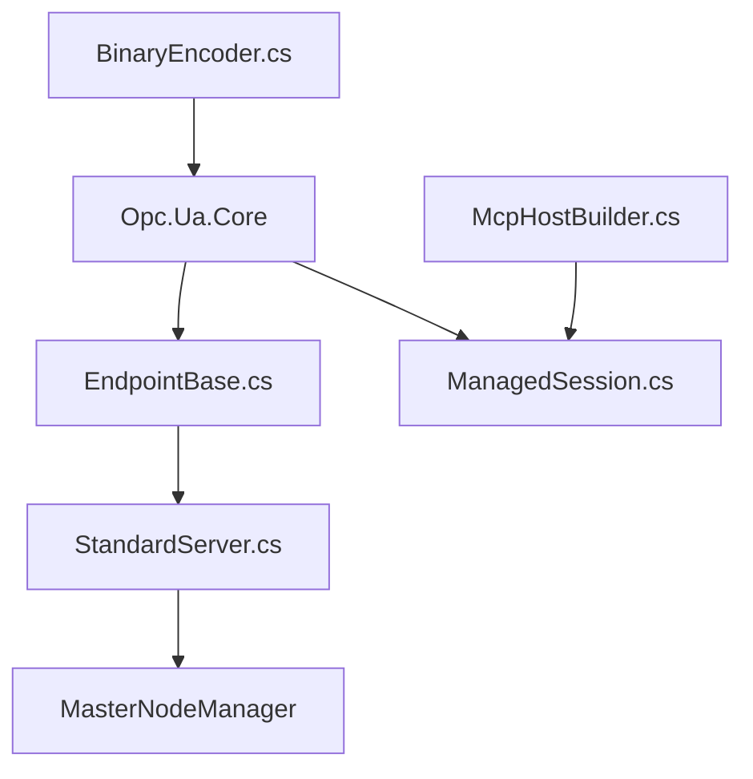

# OPCFoundation/UA-.NETStandard

> Reference .NET implementation of OPC UA: client, server, PubSub, discovery, for industry.

## The problem
Getting machines and industrial systems to talk through a standard protocol, without rewriting the stack.

## What it actually does
NuGet libraries: types and encoders, secure stack (UA-TCP, HTTPS), server with node managers, client with managed session, PubSub (UDP, MQTT, Kafka), GDS and LDS, redundancy. Code generators create managers and types from the models. An MCP server lets an LLM drive an OPC UA client. Version 2.0 breaks the API and provides a migration analyzer.

## How it is wired


## Trying it
```bash
dotnet restore UA.slnx
dotnet build UA.slnx
```

## Cost and gotchas
Free. The .NET SDK 10.0.400 or later is required to build; previews are on GitHub Packages. A license is present but not identified by GitHub. The conformance tests detect regressions and are not a certification.

## What it is not
Not a finished product: libraries to be hosted. No official certification.

## Alternatives
No alternative named in the README.

## For you
Ignore except for industrial AI projects: the OPC UA layer opens access to machine data, but you would rather go through an existing Python connector.
