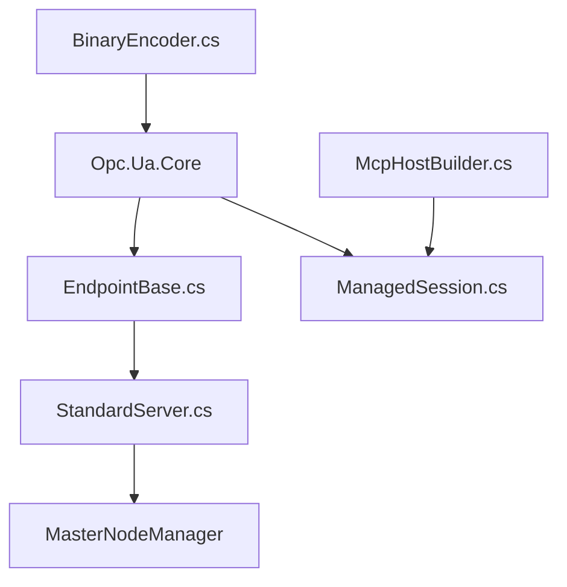

# OPCFoundation/UA-.NETStandard

> Implémentation .NET de référence d'OPC UA : client, serveur, PubSub, découverte, pour l'industrie.

## Le problème
Faire dialoguer des machines et des systèmes industriels par un protocole standard, sans réécrire la pile.

## Ce que ça fait vraiment
Bibliothèques NuGet : types et encodeurs, pile sécurisée (UA-TCP, HTTPS), serveur à gestionnaires de nœuds, client à session managée, PubSub (UDP, MQTT, Kafka), GDS et LDS, redondance. Des générateurs de code créent gestionnaires et types depuis les modèles. Un serveur MCP laisse un LLM piloter un client OPC UA. La version 2.0 casse l'API et fournit un analyseur de migration.

## Comment c'est branché


## Essayer
```bash
dotnet restore UA.slnx
dotnet build UA.slnx
```

## Coût et pièges
Gratuit. Il faut le SDK .NET 10.0.400 ou plus pour compiler ; les prévisualisations sont sur GitHub Packages. Licence présente mais non identifiée par GitHub. Les tests de conformité détectent des régressions et ne valent pas certification.

## Ce que ce n'est pas
Pas un produit fini : des bibliothèques à héberger. Pas de certification officielle.

## Alternatives
Aucune alternative nommée dans le README.

## Pour toi
À ignorer sauf projets d'IA industrielle : la couche OPC UA ouvre l'accès aux données machines, mais tu passeras plutôt par un connecteur existant en Python.

