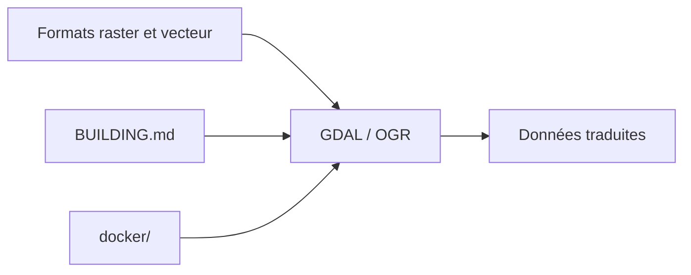

# OSGeo/gdal

> Library for translating raster and vector geospatial data formats, for geomatics specialists.

## The problem
Geospatial data exists in dozens of formats: reading and converting them requires a common layer.

## What it actually does
GDAL reads and writes raster and vector data in many formats. The README is short and points to gdal.org for documentation. It also points to BUILDING.md, Docker images and the security policy.

## How it is wired

Simplified diagram based on the sheet, no diagram provided.

## Trying it
```bash
# Aucune commande dans le README :
# voir BUILDING.md, le dossier docker/ et https://gdal.org
```

## Cost and gotchas
Free. Heavy compilation or Docker images, see BUILDING.md. The README says it is under the MIT license, but GitHub does not identify it: to be verified. 608 open issues.

## What it is not
Not a GIS with an interface: it is a library, not mapping software. The README does not detail its functions.

## Alternatives
The README names none.

## For you
Adopt if you handle geospatial data (rasters, satellite imagery): it is the reference building block under many tools, with a project funded by NumFOCUS.
